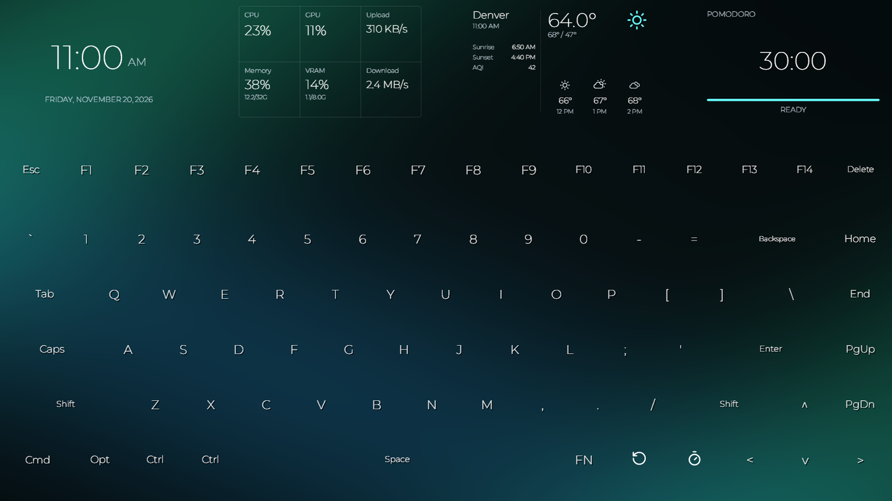
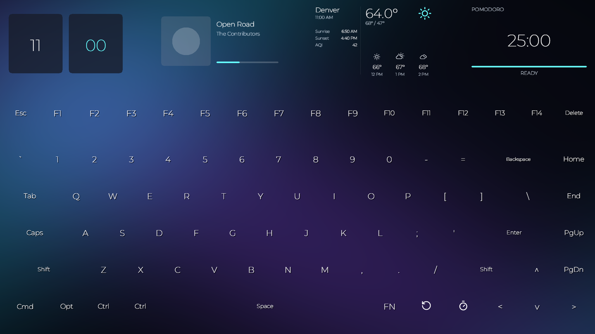
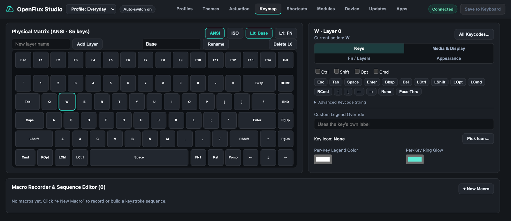
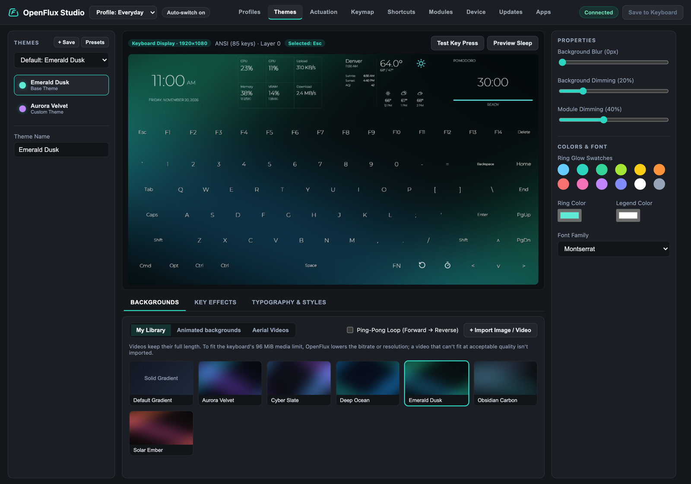
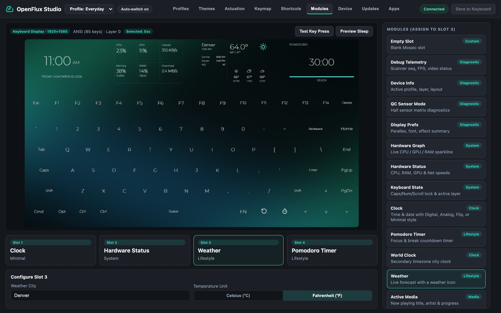
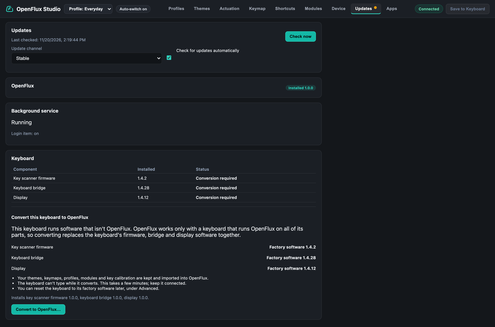

# OpenFlux



OpenFlux is open-source software for the [Flux keyboard](https://fluxkeyboard.com), a Hall-effect
keyboard with a 1920×1080 display under its keycaps. It is for owners of the
keyboard who want software they can read, change and build themselves, and it
covers the whole keyboard: the firmware of the key scanner, the programs that
run on the keyboard's built-in Linux computer and draw the display, and the
desktop software that configures the keyboard and feeds it live information.

With OpenFlux you can:

- design themes: backgrounds (images, videos and animated shaders), fonts,
  key effects and a label or icon on every key;
- edit keymaps, layers and macros, and tune each key's actuation point and
  rapid trigger;
- build the Mosaic, the row of widgets on the display: clocks, weather,
  system load, media, a Pomodoro timer and modules fed by other apps;
- switch profiles automatically with the application you are using;
- keep using third-party apps written for the keyboard's
  [published API](docs/third-party-api.md).

## What it looks like

The keyboard's display with another theme, a flip clock and the playing
track:



OpenFlux Studio, the desktop app, edits the keymap of every layer:



designs themes with a live preview of the display:



arranges the Mosaic:



and shows what the keyboard runs, with its updates:



## First five minutes

1. Install OpenFlux for macOS, Windows or Linux:
   [docs/installing.md](docs/installing.md).
2. Open OpenFlux Studio and connect the keyboard. The top bar shows
   **Connected**.
3. If the keyboard still runs other software, open **Updates** and choose
   **Convert to OpenFlux…**. It takes a few minutes, and the keyboard can't
   type meanwhile: [docs/converting-a-keyboard.md](docs/converting-a-keyboard.md).
4. Open **Themes**, pick a background and choose **Save Changes to
   Keyboard** at the top right.

## Is it safe?

- **Calibration is never written.** Each keyboard's factory calibration
  stays where it is, both when converting and when resetting.
- **Your settings come along.** Converting imports the keyboard's themes,
  keymaps, profiles, Mosaic modules and backgrounds.
- **An interrupted conversion can be restarted.** If the keyboard is
  unplugged partway, reconnect it and convert again.
- **You can go back.** Studio resets the keyboard to its factory software
  from **Updates > Advanced**. That needs an internet connection, unless
  your computer kept a copy from an earlier reset.

[docs/converting-a-keyboard.md](docs/converting-a-keyboard.md) has the
details.

## Installing

OpenFlux runs on macOS 13 or later (Apple silicon or Intel), 64-bit
Windows 10 or later, and Linux on x86_64 or aarch64 with the C library of
Ubuntu 22.04 or newer.

Download it from
[GitHub Releases](https://github.com/Scott-Meyer/openflux/releases): the
`host-v*` releases are the ones to download. They include the keyboard
software, and Studio fetches newer keyboard releases itself.
[docs/installing.md](docs/installing.md) walks through each system.

## Components

OpenFlux has four components, each versioned and released on its own:

| Component | What it is | Release tag | Source |
|---|---|---|---|
| host | OpenFlux Studio and the background service `openfluxd`, for macOS, Windows and Linux | `host-vX.Y.Z` | [`host/`](host) |
| firmware | firmware of the RP2040 key scanner | `firmware-vX.Y.Z` | [`keyboard/firmware/`](keyboard/firmware) |
| bridge | service on the keyboard's computer linking USB, the key scanner and the display | `bridge-vX.Y.Z` | [`keyboard/bridge/`](keyboard/bridge) |
| display | the keyboard's display app | `display-vX.Y.Z` | [`keyboard/display/`](keyboard/display) |

Shared code lives in [`crates/`](crates), and [`compat.toml`](compat.toml)
records which versions of the components work together.

## Building from source

With the [prerequisites](CONTRIBUTING.md#prerequisites) installed:

```sh
# Desktop software and keyboard programs: build and test
npm ci --prefix host/studio && npm run build --prefix host/studio
cargo test --workspace

# Firmware unit tests on your computer
make -C keyboard/firmware test
```

[CONTRIBUTING.md](CONTRIBUTING.md) shows how to run Studio from source and
build the firmware image and the keyboard packages.

## Documentation

- [Architecture](docs/architecture.md): the components, where they run and
  how they talk to each other
- [Installing](docs/installing.md) and
  [converting a keyboard](docs/converting-a-keyboard.md)
- [Compatibility and updates](docs/compatibility.md)
- [Third-party app API](docs/third-party-api.md)
- Protocol and format specifications: [USB](docs/protocol/usb.md),
  [serial link](docs/protocol/uart.md),
  [display channel](docs/protocol/display-ipc.md),
  [keymap](docs/protocol/keymap-format.md),
  [calibration storage](docs/protocol/calibration-storage.md)
- [Contributing](CONTRIBUTING.md) and [releasing](docs/releasing.md)
- [Security policy](SECURITY.md)

## License

OpenFlux is licensed under either of the [MIT License](LICENSE-MIT) or the
[Apache License, Version 2.0](LICENSE-APACHE), at your option. Third-party
components keep their own licenses; [NOTICE](NOTICE) lists them, and
[assets/LICENSE_MANIFEST.md](assets/LICENSE_MANIFEST.md) lists the fonts and
icons. The FFmpeg tools bundled with the host installers are licensed under
the GPL ([releasing.md](docs/releasing.md#published-files)).

Weather data is by [Open-Meteo.com](https://open-meteo.com/), under CC BY 4.0.

OpenFlux is an independent project, not affiliated with or endorsed by the makers of the Flux
keyboard. "Flux" is used only to identify the hardware OpenFlux runs on.
