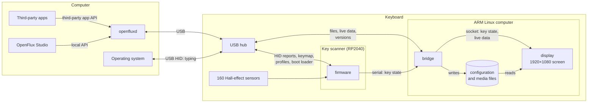

# Architecture

The keyboard contains two computers. A **key scanner**, an RP2040
microcontroller, reads 160 Hall-effect sensors under the keys and acts as
the USB keyboard. A small **ARM Linux computer** drives the 1920×1080 display
under the keycaps. Both sit behind a USB hub inside the keyboard, so the
computer it is plugged into sees two USB devices.

OpenFlux is the software for all of it: firmware for the key scanner, two
programs for the keyboard's computer, and the desktop software that
configures the keyboard and feeds it live information.

Typing goes from the firmware straight to the operating system. Everything
else goes through `openfluxd`, which owns the USB connection to both keyboard
parts; Studio and third-party apps talk only to it.

## Components

| Component | Runs on | Released as | Source |
|---|---|---|---|
| **firmware** | the RP2040 key scanner | `openflux-firmware-X.Y.Z.uf2` | `keyboard/firmware` (C, Pico SDK) |
| **bridge** | the keyboard's computer | `openflux-bridge_X.Y.Z_aarch64.ipk` | `keyboard/bridge` (Rust) |
| **display** | the keyboard's computer | `openflux-display_X.Y.Z_aarch64.ipk` | `keyboard/display` (Rust) |
| **host** | the computer the keyboard is plugged into | installers for macOS, Windows and Linux | `host/` (Rust, TypeScript, Swift) |

Each component has its own version and release; `compat.toml` records which
versions work together ([compatibility.md](compatibility.md)). The bridge
and display are `.ipk` files, the opkg package format of the keyboard's
Linux operating system. That operating system is not part of OpenFlux;
OpenFlux installs its programs on it and starts them at boot.

### Firmware

The firmware scans the sensors, turns readings into key presses with each
key's actuation settings, and sends standard USB HID keyboard and consumer
reports, so typing needs no software on the computer. It stores the keymap,
the profile settings and the unit's calibration in its own flash
([calibration-storage.md](protocol/calibration-storage.md)).

It also has a USB command interface for the host (keymap, active
profile, input language, entering its boot loader) and a serial link to the
bridge, over which it reports key state continuously.

### Bridge

The bridge is a small service that connects the keyboard's computer to
everything else:

- it is a USB gadget for the host: version queries, file transfer within
  `/home`, setting the clock, and relaying live data
  ([usb.md](protocol/usb.md));
- it reads the firmware's key-state messages from the serial link
  ([uart.md](protocol/uart.md));
- it serves both to the display over a local socket
  ([display-ipc.md](protocol/display-ipc.md)).

The bridge package also installs the launcher the keyboard runs at boot. It
starts the bridge and the display, restarts either if it exits, restarts a
display that stops drawing, and restores the previous bridge after an
update the host never confirmed.

### Display

The display draws the keyboard's screen: a label or icon on every key,
key-press effects, the theme's background (image, video or procedural
shader), and the Mosaic, a row of four widgets such as clocks, weather,
system load, media and a Pomodoro timer. It renders with the GPU and decodes
video in hardware, with software fallbacks for both.

It reads its configuration from JSON files the host writes, and follows key
state and live data from the bridge.

### Host

| Program | Role |
|---|---|
| `openfluxd` | The daemon. Runs per user from login. Owns the USB connection to both keyboard devices, keeps the configuration, samples system load, media playback, the active application and the input language, fetches weather, and serves the local API. |
| OpenFlux Studio | The desktop app, built with Tauri. Edits themes, keymaps, profiles, the Mosaic and actuation, shows a live preview, and installs updates. It talks only to `openfluxd`. |
| `openflux-tray`, `openflux-sensors` | macOS helpers for the menu bar icon and system sensors. On Windows and Linux the daemon does both itself. |
| `openflux-ffmpeg`, `openflux-ffprobe` | Convert imported videos to a format the keyboard plays, and read their durations. |

Studio's preview is drawn on the computer by the display's own renderer
(the `openflux-display` crate in `keyboard/display`), so what Studio shows is
what the keyboard draws.

The daemon's API listens only on the loopback interface, over HTTPS with a
self-signed certificate. OpenFlux's own clients enroll with a secret in the
user's data directory. The same server implements the
[third-party app API](third-party-api.md), so existing apps that customize
the keyboard keep working.

The daemon stores its data in `~/.local/share/openflux` on macOS and Linux and
in `%LOCALAPPDATA%\openflux` on Windows.

## Data flow

**Typing.** The firmware sends HID reports directly to the computer. In
parallel, every change of the pressed keys goes to the bridge as a key-state
message and on to the display, which draws the key effects. Neither path
involves the computer's software.

**Changing the configuration.** Studio sends a change to the daemon. When
the user saves to the keyboard, the daemon:

1. encodes the keymap and actuation modes as a keymap blob and sends it to
   the firmware ([keymap-format.md](protocol/keymap-format.md)), along with
   the profile settings;
2. writes the JSON documents (`appearance`, `settings`, `mosaic`, `keymap`,
   `profiles`) and any media the keyboard doesn't have yet through the bridge;
3. keeps what the keyboard held before, and restores it if any step fails.

The display notices the changed files and redraws.

**Live information.** The daemon samples the computer continuously and sends
the display a live-data message whenever something changes: system load,
the playing track, weather, labels for the active application's shortcuts,
the active theme. The bridge passes it on to the display
([display-ipc.md](protocol/display-ipc.md#live-data-from-the-host)).

**Weather.** While a Mosaic layout has a weather tile, the daemon looks up the
tile's city, its forecast and its air quality with
[Open-Meteo](https://open-meteo.com/). Without a weather tile, OpenFlux
makes no weather requests.

**Profiles.** Each profile pairs a theme, shortcut contexts (the key labels
that show an application's shortcuts) and an actuation mode, and can be tied
to an application. When the active application
changes, the daemon tells the firmware which profile to use; the firmware
switches its actuation mode and default layer, and the display switches the
theme. Keys on the keyboard can also cycle profiles, themes and actuation
modes.

**Updates.** The daemon checks the signed update index, verifies every
download, and installs keyboard components only when the user asks:
firmware through the RP2040 boot ROM, bridge and display as packages
uploaded through the bridge. [compatibility.md](compatibility.md) describes
how it chooses what to offer and in which order to install it, and
[releasing.md](releasing.md) how releases are published.

## Where things are on the keyboard

| Path | Contents |
|---|---|
| `/usr/lib/openflux/bridge/`, `/usr/lib/openflux/display/` | the installed programs and their resources |
| `/home/root/openflux/config/` | configuration written by the host |
| `/home/root/openflux/media/` | backgrounds and key icons |
| `/home/root/openflux/logs/` | logs, and state the display publishes for the host |
| `/home/root/.openflux/` | installed versions and update rollback state |
| `/tmp/openflux_bridge.sock` | the bridge's display socket |

## Protocol and format specifications

| Document | Covers |
|---|---|
| [protocol/usb.md](protocol/usb.md) | USB devices, command framing, bridge and firmware commands |
| [protocol/uart.md](protocol/uart.md) | the serial link between firmware and bridge |
| [protocol/display-ipc.md](protocol/display-ipc.md) | the display socket, live data and the display's configuration files |
| [protocol/keymap-format.md](protocol/keymap-format.md) | keymap document, keymap blob, actuation and profile settings |
| [protocol/calibration-storage.md](protocol/calibration-storage.md) | the firmware's flash file system and calibration files |
| [third-party-api.md](third-party-api.md) | the API for third-party apps |
