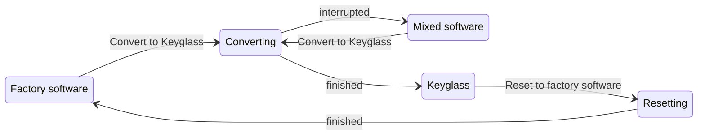
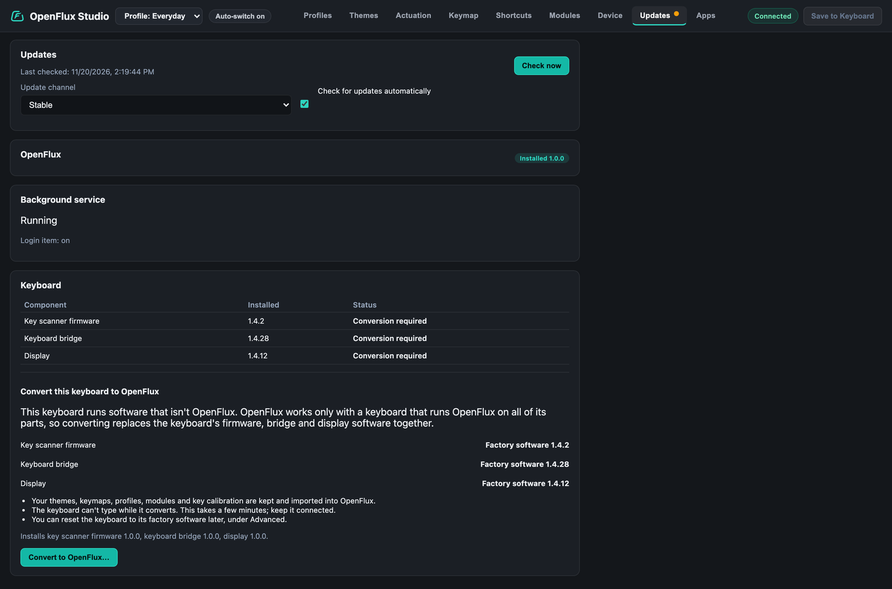

# Converting a keyboard to Keyglass

A keyboard runs either Keyglass on all of its parts or other software. When
Keyglass Studio finds a keyboard that is not fully running Keyglass, such as
one with the keyboard's factory software, it shows **Conversion required**
and offers one action for the keyboard: converting it. Converting installs
Keyglass on every part of the keyboard at once.

You can return the keyboard to its factory software at any time with
**Reset to factory software**.

Studio shows both factory and mixed software as **Conversion required**.

## Before you start

- Install Keyglass on your computer ([installing.md](installing.md)) and open
  Keyglass Studio.
- Quit any other program that configures the keyboard, including the
  keyboard's factory desktop app. Only one program can talk to the keyboard
  at a time. Closing a program's window doesn't always quit it: if it has an
  icon in the menu bar or the notification area, quit it from there, and
  check that it isn't set to open at login (**System Settings > General >
  Login Items** on macOS, the startup apps in Task Manager on Windows).
- Connect the keyboard directly to the computer or to a powered hub, and
  keep it connected until the conversion has finished.

## Converting

1. In Keyglass Studio, open **Updates**. Under **Keyboard**, Studio shows
   **Conversion required**, what each part of the keyboard runs, and what
   converting installs: the firmware for the key scanner, and the bridge and
   display for the keyboard's computer, with their versions.
2. Choose **Convert to Keyglass…** and confirm.
3. Studio installs each part, imports your settings and shows its progress.
   The keyboard can't type until the conversion has finished, and its screen
   goes blank while the display is replaced. While the firmware is being
   written, your computer may show a drive named `RPI-RP2`; leave it alone.
   This takes a few minutes; use another keyboard if you need to type in the
   meantime.
4. When every part runs Keyglass, Studio says so, and you can use the
   keyboard as before.

The installers carry the keyboard software that matches them, so converting
works without an internet connection.

As its last step, the conversion fetches the keyboard maker's
press-refinement data and stores it on the keyboard, where the firmware uses
it to refine key detection. If that can't finish,
for example offline, the conversion still succeeds, and you can install the
data later from Studio's **Device** page.

### What is kept

- **Your keyboard settings.** Themes, keymaps, profiles, the Mosaic modules
  and your backgrounds are carried over and appear in Keyglass Studio.
- **Calibration.** Each keyboard is calibrated individually at the factory.
  The calibration stays where it is on the keyboard and is never rewritten.

### If something goes wrong

If the keyboard is unplugged or the computer sleeps during the conversion,
reconnect the keyboard. Studio shows it as **Conversion required** again,
because some parts don't run Keyglass yet, and you can start the conversion
again from the beginning.

If the screen stays blank but the keyboard types, leave it connected for a
minute; the keyboard restarts its display by itself. If it doesn't
recover, unplug the keyboard, plug it in again and repeat the conversion.

If writing the firmware fails and the keyboard doesn't come back, Studio
says so. Copy the firmware `.uf2` file from the Keyglass release onto the
`RPI-RP2` drive, then check for updates in Studio.

## Reset to factory software

To return the keyboard to its factory software:

1. In Keyglass Studio, open **Updates**, expand **Advanced** under
   **Keyboard**, and choose **Reset to factory software…**.
2. Confirm twice. Studio downloads the keyboard's factory software from its
   official source, checks the download against the signed update index,
   and installs it on every part of the keyboard. The keyboard can't type
   while this runs.

Resetting needs an internet connection unless your computer already has a
verified copy of the factory software from an earlier reset. Afterwards the
keyboard works with its factory desktop app, and Keyglass Studio shows it as
**Conversion required** until you convert it again. You can remove Keyglass
from your computer as described in [installing.md](installing.md).

What the reset keeps:

- **Calibration** stays on the keyboard, untouched.
- **The keymap** stays: the factory firmware gets the keymap the keyboard
  has now. A media key the factory firmware can't express goes back to that
  key's default.
- **Other changes you made in Keyglass Studio** don't carry over to the
  factory software. The conversion only read the factory software's own
  settings and left them in place.

## Updates after converting

Once converted, each part of the keyboard is updated separately, and only
when you choose to install an update. [compatibility.md](compatibility.md)
explains the states Studio shows and how updates are planned.

## Troubleshooting

**Press-refinement data won't download.** On **Device**, choose **Use a file
I already have…** and pick the keyboard maker's 1.5.0.5 Windows package
(`polymath.msix`) or its key scanner firmware (`.uf2`); this works on any
computer. The file is checked against the signed update index like a
download, and Studio keeps a copy so the data can be installed again
offline.
