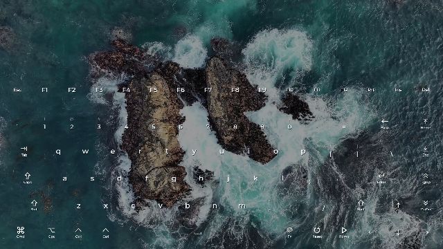

# Media Background

`v2.0.0` · **Core Built-In** · Sandboxed Lua (runs on keyboard)

Displays a local 1080p looping video or image as the compositor background with adjustable background dimming for key legend clarity

## Settings

- **Video or Image File** (`media_path`, file)
- **Background Dimming (%)** (`bg_dimming`, number)

## Runtime & Permissions

- **Sandboxed Lua 5.4 only** — runs directly on the keyboard with a 150 ms execution watchdog and no shell or filesystem write access.

## Installing & Customizing

- Ships built into **Keyglass Studio**. Toggle it under **Manage Modules**, or click **Fork to Local** to customize its code under `~/.local/share/openflux/v2/modules/local/`.
