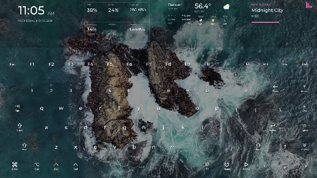

# Top Bar Dock

`v2.0.0` · **Core Built-In** · Sandboxed Lua (runs on keyboard)

Provides the top-bar widget slot layout, optional frosted module dimming backdrop for readability, and vertical slot dividers (pure module—fork or replace for custom layouts!)

## Settings

- **Number of Top Slots** (`slot_count`, select)
- **Top Bar Tint Dimming (%)** (`module_dimming`, number)
- **Show Slot Dividers** (`show_dividers`, boolean)

## Runtime & Permissions

- **Sandboxed Lua 5.4 only** — runs directly on the keyboard with a 150 ms execution watchdog and no shell or filesystem write access.

## Installing & Customizing

- Ships built into **Keyglass Studio**. Toggle it under **Manage Modules**, or click **Fork to Local** to customize its code under `~/.local/share/openflux/v2/modules/local/`.
