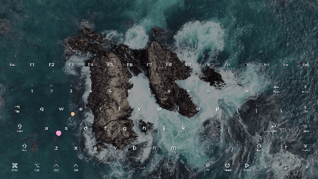

# Key-Bouncing & Refracting Particles

`v2.0.0` · **Core Built-In** · Sandboxed Lua (runs on keyboard)

Sparks burst upward, ricochet inside clear keycaps, then fall, pile up and spill off the sides

## Settings

- **Average Dots Per Press** (`count`, number)
- **Inside Key Wall Bounce Probability** (`bounce_chance`, number)
- **Keycap Lens Magnification** (`lens_refract`, number)
- **Primary Spark Color** (`color_a`, color)
- **Secondary Spark Color** (`color_b`, color)

## Runtime & Permissions

- **Sandboxed Lua 5.4 only** — runs directly on the keyboard with a 150 ms execution watchdog and no shell or filesystem write access.

## Installing & Customizing

- Ships built into **Keyglass Studio**. Toggle it under **Manage Modules**, or click **Fork to Local** to customize its code under `~/.local/share/keyglass/v2/modules/local/`.
