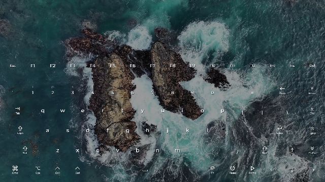

# Custom Keycap Visuals

`v2.0.0` · **Core Built-In** · Sandboxed Lua (runs on keyboard)

Per-key and per-action visual overrides (custom labels, colors, borders, vector icons, and PNG images) layered cleanly above base keymap and shortcuts

## Runtime & Permissions

- **Sandboxed Lua 5.4 only** — runs directly on the keyboard with a 150 ms execution watchdog and no shell or filesystem write access.

## Installing & Customizing

- Ships built into **Keyglass Studio**. Toggle it under **Manage Modules**, or click **Fork to Local** to customize its code under `~/.local/share/keyglass/v2/modules/local/`.
