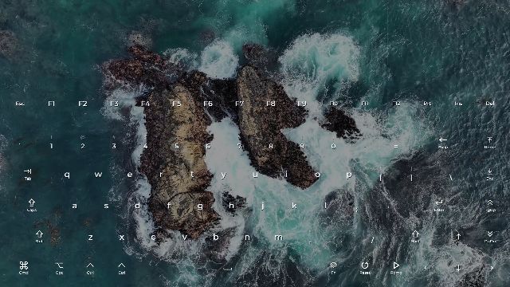

# Base Keymap Legends

`v2.0.0` · **Core Built-In** · Sandboxed Lua (runs on keyboard)

Publishes base keycap legends with dynamic Shift case (a/A), shifted symbols (1/!), Caps Lock badge, and Fn layer media keys onto `keys/providers/keymap`

## Settings

- **Lowercase Letters When Unshifted** (`lowercase_default`, boolean)
- **Base Keycap Legends** (`legend_visibility`, select)

## Runtime & Permissions

- **Sandboxed Lua 5.4 only** — runs directly on the keyboard with a 150 ms execution watchdog and no shell or filesystem write access.

## Installing & Customizing

- Ships built into **Keyglass Studio**. Toggle it under **Manage Modules**, or click **Fork to Local** to customize its code under `~/.local/share/keyglass/v2/modules/local/`.
