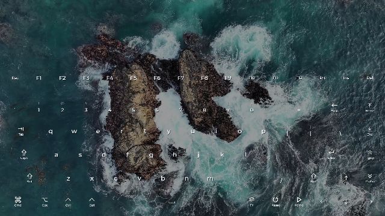

# Key Legends & Icons Renderer

`v2.0.0` · **Core Built-In** · Sandboxed Lua (runs on keyboard)

Core modular key-face compositor: resolves all `keys/providers/#` claims (keymap, Shift case, v1 shortcuts, game ability decks) in one atomic zero-flash frame with full parallax alignment

## Settings

- **Number & Symbol Shift Style** (`legend_style`, select)
- **Crisp Bold Legends** (`bold_legends`, boolean)
- **Default Legend Color** (`legend_color`, color)
- **Shortcut Icon Accent** (`shortcut_color`, color)

## Runtime & Permissions

- **Sandboxed Lua 5.4 only** — runs directly on the keyboard with a 150 ms execution watchdog and no shell or filesystem write access.

## Installing & Customizing

- Ships built into **Keyglass Studio**. Toggle it under **Manage Modules**, or click **Fork to Local** to customize its code under `~/.local/share/keyglass/v2/modules/local/`.
