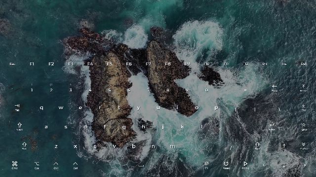

# App & OS Shortcuts

`v2.0.0` · **Core Built-In** · Sandboxed Lua (runs on keyboard)

Classic v1 dynamic shortcut icons (Copy, Paste, Cut, Undo, Save, Find, plus active-app shortcut packs) when holding Cmd/Ctrl/Alt

## Settings

- **Shortcut Icon Color** (`accent`, color)

## Runtime & Permissions

- **Sandboxed Lua 5.4 only** — runs directly on the keyboard with a 150 ms execution watchdog and no shell or filesystem write access.

## Installing & Customizing

- Ships built into **Keyglass Studio**. Toggle it under **Manage Modules**, or click **Fork to Local** to customize its code under `~/.local/share/keyglass/v2/modules/local/`.
