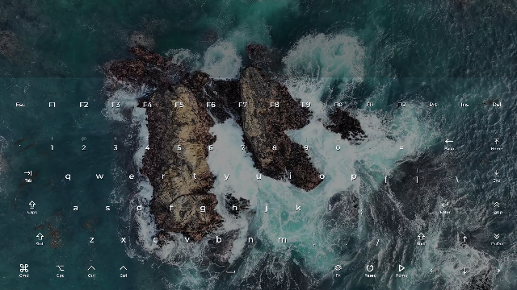

# OSD Toast & Volume HUD

`v2.0.0` · **Core Built-In** · Sandboxed Lua (runs on keyboard)

macOS-style frosted glass HUD pill for volume, brightness, alerts, and notifications published to `ui/toast` (fork or replace via role `osd_toast`!)

## Settings

- **HUD Position** (`position`, select)
- **Default Accent Color** (`default_accent`, color)

## Bindable Key Actions

Bind any of these actions to a physical key in **Keyglass Studio → QMK Keymap → Module Actions**:

- **Preview Volume HUD** (`test_volume`, tap)
- **Preview Alert Toast** (`test_alert`, tap)

## Runtime & Permissions

- **Sandboxed Lua 5.4 only** — runs directly on the keyboard with a 150 ms execution watchdog and no shell or filesystem write access.

## Installing & Customizing

- Ships built into **Keyglass Studio**. Toggle it under **Manage Modules**, or click **Fork to Local** to customize its code under `~/.local/share/openflux/v2/modules/local/`.
